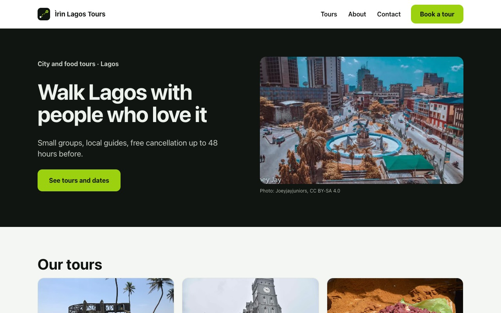
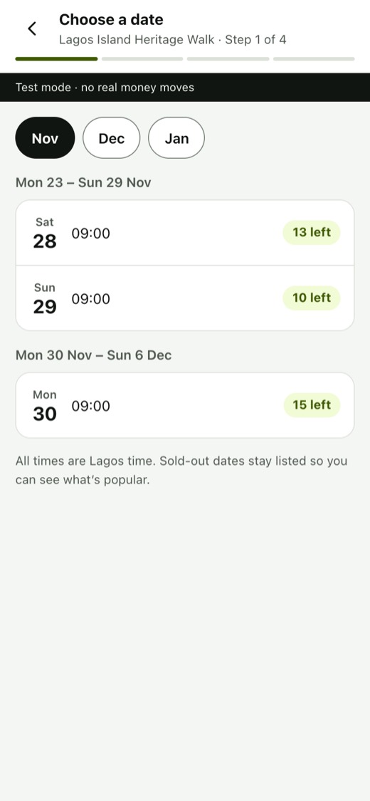
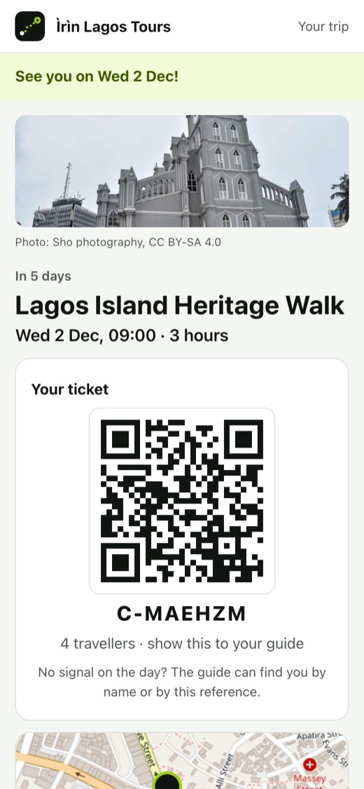
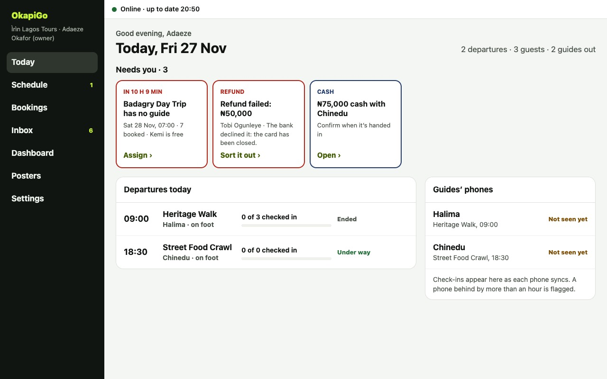
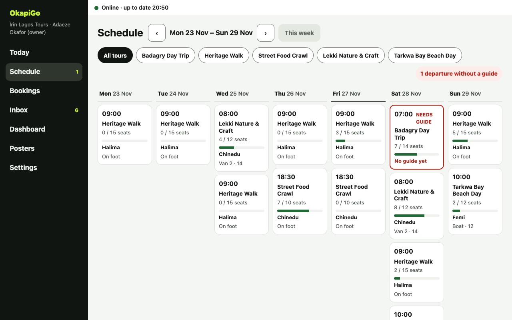
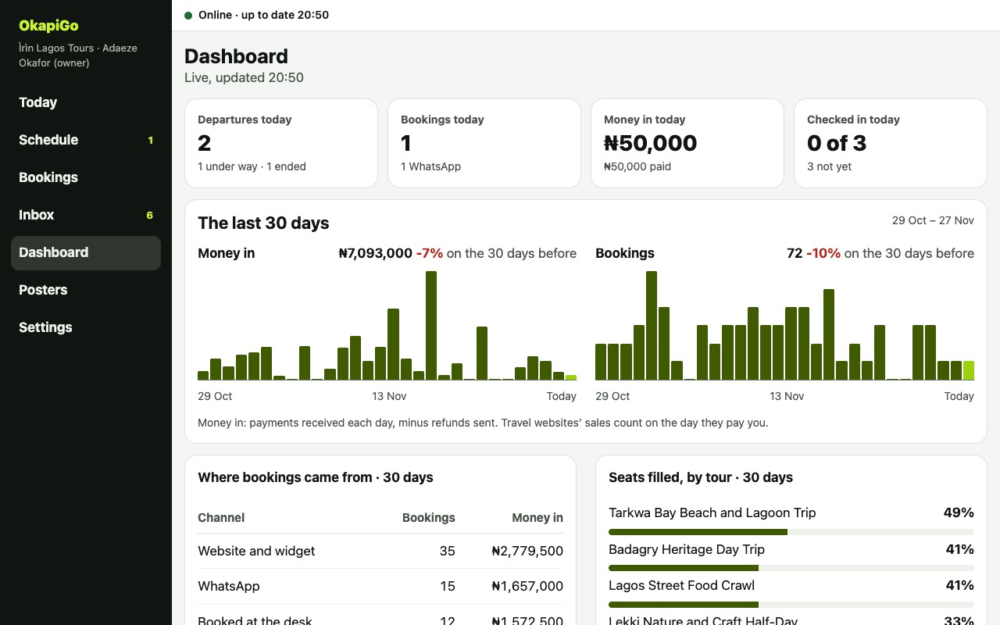

# OkapiGo

Booking, payments and operations for Nigerian tour operators.

A guest finds a tour on the operator's website, on WhatsApp or on a travel site, and pays in
Naira. On the day, a guide checks them in with no signal. The office runs everything from one
screen, and the ledger agrees with the bank.

This is an MVP and a portfolio project. Everything runs locally against one fictional business,
**Ìrìn Lagos Tours**, which comes with 60 days of history and five tours.

| The operator's website                   | A tour, on a phone                           | Checkout                                   | The guest's trip page                        |
| ---------------------------------------- | -------------------------------------------- | ------------------------------------------ | -------------------------------------------- |
|  |  |  |  |

| The office's Today                         | Schedule                                         | Dashboard                                          |
| ------------------------------------------ | ------------------------------------------------ | -------------------------------------------------- |
|  |  |  |

## What it does

**For guests**

- **The operator's website**, in three styles, plus a **booking widget** to embed on any site.
  Tour pages have photos and credits, and a link preview with the cover photo.
- **Checkout in four steps:** date, who's coming (adult and child prices), details, then pay by
  card or bank transfer. Guests can pay a **deposit** now and the balance later through a
  **payment link**.
- **Booking on WhatsApp:** a chat bot takes the booking and sends a payment link, then the
  ticket. Staff can take the chat over at any point.
- **The trip page:** a QR ticket, the meeting point on a map, "pay the balance", change or
  cancel under the tour's policy (the refund is worked out for you), and questions for the team.
- **An AI companion** on the trip page. It answers from the operator's own notes. When it isn't
  sure, it passes the question to the team, and their reply appears on the trip page.

**For the operator's staff** (an installable app at `/app/`)

- **Guides, offline:** the day's manifest, QR scanning, check-ins, no-shows and cash collected,
  all with no signal. Everything syncs once the phone is back online, and conflicts are settled.
- **Today:** what needs a person now (a departure with no guide, a failed refund, cash to
  confirm), and every departure live.
- **Schedule:** assign guides and vans, and cancel a departure (refunds go out by themselves).
- **The bookings desk:** search, take payments, send links, change travellers, move dates,
  cancel and refund.
- **The inbox:** WhatsApp chats, guests' questions and requests, and alerts that clear by
  themselves.
- **Posters** for social media (four templates, with a QR code to book), and a **dashboard**
  read from the ledger.
- **Settings:** tours (photos, prices, schedules, extras, pickups, cancellation policies), the
  website, messages, WhatsApp, staff and roles, and sales channels.

**Underneath**

- **No double-selling.** Seats are held with row locks, and holds expire as background jobs.
  This also holds across channels: the website, WhatsApp, the desk and travel sites share the
  same seats.
- **Money is a double-entry ledger** in kobo (whole numbers, no floats), with VAT at 7.5%
  included. Payments, refunds, deposits, cash and travel-site sales all post to it, and it is
  reconciled against Paystack.
- **Travel sites connect over OCTO**, the open standard for tour bookings. **Sojourna**, a mock
  travel site in `apps/mock-ota`, books through it the way a real one would.
- **Accessibility:** every guest page is checked with axe in a real browser, against WCAG 2.1 AA
  and axe's best practices, in every style, light and dark, on a phone and a desktop.

## Run it locally

You need **Node.js 24** (`nvm use` reads `.nvmrc`), **pnpm 11** (`corepack enable`) and **Docker
Desktop**.

```bash
cp .env.example .env      # local settings; works as it is
pnpm install
pnpm services:up          # PostgreSQL, Redis and Mailpit, in Docker
pnpm db:reset             # build the database and load the demo business (wipes local data)
pnpm dev                  # every app, with auto-reload
```

| Open                                        | What                                                                                                |
| ------------------------------------------- | --------------------------------------------------------------------------------------------------- |
| <http://localhost:5173/irin-lagos-tours>    | the operator's website (the guest side)                                                             |
| <http://localhost:5175/app/>                | the staff app (sign in below)                                                                       |
| <http://localhost:5174/simulator/whatsapp/> | the WhatsApp simulator: chat with the booking bot                                                   |
| <http://localhost:4400>                     | Sojourna, the mock travel site                                                                      |
| <http://127.0.0.1:8025>                     | Mailpit: the emails the app sends (none leave your machine; the demo business's are kept, not sent) |
| <http://localhost:4000/health>              | the API's health check                                                                              |

**Signing in to the staff app:** enter a staff email or phone, then copy the 6-digit code from
the `pnpm dev` terminal (look for `🔑`). The staff are all `@irin-lagos-tours.example`:

| Who           | Role    | Email      | Phone           |
| ------------- | ------- | ---------- | --------------- |
| Adaeze Okafor | owner   | `adaeze@`  | `0803 000 0001` |
| Tunde Bakare  | manager | `tunde@`   | `0803 000 0002` |
| Kemi Adeyemi  | guide   | `kemi@`    | `0803 000 0003` |
| Chinedu Eze   | guide   | `chinedu@` | `0803 000 0004` |
| Halima Bello  | guide   | `halima@`  | `0803 000 0005` |
| Femi Ogunleye | guide   | `femi@`    | `0803 000 0006` |

**Paying:** payments go through a built-in **simulator** by default, so no account is needed:
"Pay" opens a stand-in for Paystack's page. To use **Paystack test mode**, put your test keys in
`.env` (`PAYSTACK_SECRET_KEY=sk_test_…`, `PAYSTACK_PUBLIC_KEY=pk_test_…`) and set
`PAYMENT_PROVIDER=paystack`. **Live keys are refused:** the API won't start with one.

**The AI companion** runs on a fake by default. To use Claude, set `AI_PROVIDER=anthropic` and
`ANTHROPIC_API_KEY` in `.env`. Spending is capped each month (`AI_MONTHLY_CAP_USD`).

**A walkthrough:** [`docs/demo-script.md`](docs/demo-script.md) takes you through the main
journeys in about 15 minutes.

## How it's built

Node.js 24 (JavaScript, ES modules, type-checked with JSDoc) · **Express 5** · **Zod 4** ·
**Prisma 7** on **PostgreSQL 17** · **Redis** and **BullMQ** for background jobs · **React 19**
and **Vite** · **Vitest** and **Playwright** · **pnpm** workspaces and **Turborepo**.

| Folder              | What                                                                      |
| ------------------- | ------------------------------------------------------------------------- |
| `apps/api`          | the API (Express). The only thing that writes to the database             |
| `apps/workers`      | background jobs: hold expiry, schedules, webhooks, reminders, the reset   |
| `apps/web`          | the guest side: website, checkout, trip page, widget; the e2e tests       |
| `apps/operator`     | the staff app (an installable PWA, works offline for guides)              |
| `apps/simulators`   | the WhatsApp simulator                                                    |
| `apps/mock-ota`     | Sojourna, the mock travel site (an OCTO client)                           |
| `packages/db`       | the database schema, migrations, the demo data, and the booking rules     |
| `packages/shared`   | rules both the server and the browsers use: money, time, pricing, checks  |
| `packages/payments` | Paystack (test mode) and the payment simulator                            |
| `packages/ai`       | the AI companion: Claude, or a fake                                       |
| `packages/media`    | photos and logos: checked, resized, stripped of hidden details, stored    |
| `packages/jobs`     | queue names and the job client                                            |
| `docs/`             | flow briefs, designs, the project log and a learning note for every stage |

**How it was made:** in small stages, one at a time. Each stage was built by pairing with
Claude (Anthropic's AI) and then tested. [`docs/PROJECT-LOG.md`](docs/PROJECT-LOG.md) records
every stage and decision, and [`docs/learning/`](docs/learning/) explains each stage.

## Testing

```bash
pnpm test                              # unit and integration tests (needs pnpm services:up)
pnpm --filter @okapigo/web e2e         # end-to-end tests in Chrome
pnpm lint && pnpm format:check
```

- **About 1,900 unit and integration tests.** They run against real PostgreSQL and Redis, in
  their own databases, so your dev data is never touched.
- **15 end-to-end tests** run in a real browser against the built apps. They cover the eight
  journeys: book and pay on the website; book on WhatsApp; book on a travel site; cancel from
  the trip page; deposit and then the balance; a guide checking in offline; the AI companion;
  posters and the dashboard. There are also tests for the widget and for accessibility.
- **Mutation checks** for every stage: the code is broken on purpose to prove a test catches it.
- **CI** runs lint, formatting, the tests, a size budget for the guest web, the end-to-end
  tests and a dependency audit on every push.

## Honest limits

- **Not deployed yet.** It runs locally. Hosting comes in December 2026.
- **Test money only.** The payment simulator, or Paystack's test mode. The app refuses live keys.
- **Staff sign-in codes are written to the API's log**, not sent by email or SMS.
- **WhatsApp** goes to the simulator. The real WhatsApp Cloud API is wired up, but it needs
  Meta's approval for message templates first.
- **Sojourna is a mock.** OCTO is built to the standard but has only been tested against our
  own client, not a real travel site.
- **Photos are stored on local disk** (`.data/media`). Cloud storage comes with hosting.
- **One business, one country.** Built for Naira, VAT at 7.5% and Lagos time. Anyone can sign
  up a business, but there's no billing for operators.
- **The demo's data is fictional.** The tour photos are from Wikimedia Commons, credited on the
  site (see `packages/db/src/seed/photos/CREDITS.md`).
- **`pnpm db:reset` late in the day** places "today" from the time you run it, so today's
  earlier departures are missing. The nightly reset runs at 04:00 Lagos time and doesn't have
  this problem.

## Everyday commands

| Command               | What it does                                                   |
| --------------------- | -------------------------------------------------------------- |
| `pnpm dev`            | run every app in watch mode                                    |
| `pnpm test`           | run the unit and integration tests                             |
| `pnpm lint`           | check the code for likely bugs (ESLint)                        |
| `pnpm format`         | format everything (Prettier)                                   |
| `pnpm db:reset`       | **wipe the local database**, run the migrations, load the demo |
| `pnpm demo:reset`     | delete the demo business and make it again, with fresh history |
| `pnpm db:studio`      | browse the database in your browser (Prisma Studio)            |
| `pnpm services:down`  | stop PostgreSQL, Redis and Mailpit (data is kept)              |
| `pnpm services:reset` | stop them **and wipe all local data**, then restart            |
